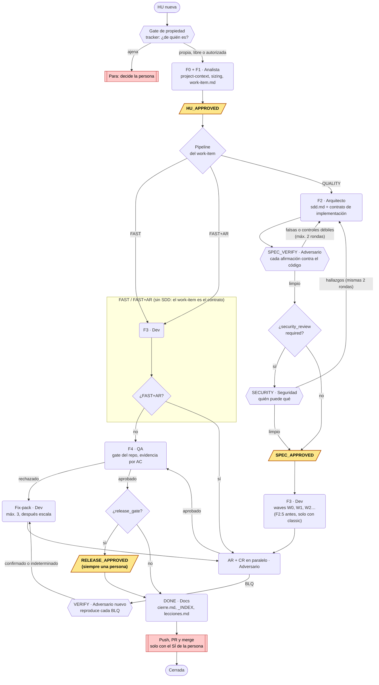
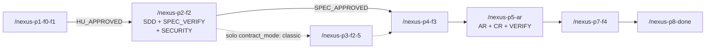

# NexusAgile Enterprise

> *"La persona decide QUÉ. Los agentes deciden CÓMO."*

NexusAgil es una metodología de desarrollo con agentes para Claude Code. Procesa una Historia de Usuario (HU) por vez, por fases, con agentes especializados, gates que da una persona y un hook que hace cumplir las reglas que no deben depender de la memoria del modelo.

Se distribuye como plugin de Claude Code (`.claude-plugin/plugin.json`, versión **2.0.0-rc.5**). Es independiente del stack: F0 lee el proyecto real y genera `project-context.md`.

**Estado:** release candidate. El supervisor de AUTO es experimental. Las mediciones están en [Evaluación](#evaluación).


## El problema que resuelve

| Problema | Qué hace NexusAgil |
|---|---|
| La IA inventa imports y módulos | **Codebase Grounding**: lee archivos reales antes de generar nada |
| La IA crea patrones inconsistentes | **Exemplar Pattern**: cada archivo a tocar referencia uno existente |
| La IA no conoce el stack ni el producto | **Dos contextos vivos**: `project-context.md` (stack, patrones, guardas) y `product-context.md` (negocio, personas, decisiones) |
| La IA ignora restricciones | **Constraint Directives**: OBLIGATORIO / PROHIBIDO explícitos por tarea |
| La implementación se aleja del plan | **Drift Detection** en QA: plan contra implementación |
| El SDD afirma cosas falsas del código | **SPEC_VERIFY**: un agente aparte verifica cada afirmación del SDD contra el código, y el hook no deja empezar F3 con falsas abiertas |
| Los errores se repiten entre sesiones | **Auto-Blindaje + memoria (Engram)**: los hechos verificados se guardan atados al hash de git de su archivo; las lecciones, solo si una persona las aprueba |
| Dos agentes (o dos personas) hacen la misma HU | **Gate de propiedad**: antes de F0 se consulta el tracker, y el hook no deja empezar una HU ajena |
| Contexto saturado y alucinaciones | **Protocolo de sub-agentes**: cada fase empieza con contexto limpio |
| La IA recuerda otra versión de una librería | **Versión instalada**: el SDD anota la versión instalada y dónde se verificó cada símbolo externo |
| Un sub-gate en verde esconde un gate en rojo | **El gate del repo corre en F4**: QA corre una vez el comando único del proyecto |
| La IA sobredimensiona una integración chica | **Presupuesto de escala**: el SDD declara el tamaño esperado del diff y el check 7 del CR lo compara con el real |
| Un test pasa porque no puede fallar | **Controles vacíos**: antes de contar un control, su fixture debe fallar sin el fix y su mutante debe morir por el motivo literal |
| Números de la documentación que se alejan del código | **Afirmaciones con testigo** (check 8 del CR): cada número se re-deriva o se fecha como foto |
| Se cargan skills que no hacen falta | **Skills Router**: 1 o 2 skills de dominio por HU |


## Cómo fluye una HU

Las cajas redondeadas son agentes, los hexágonos son verificaciones y las cajas en negrita son gates. Entre dos gates, todo corre solo.



El hook hace cumplir la forma de este gráfico: una fase no arranca sin el artefacto y el gate anteriores, F3 no arranca con afirmaciones falsas ni hallazgos de seguridad abiertos, F4 no arranca con BLQ abiertos y DONE no arranca sin `validation.md` aprobado. Los topes de rondas, la verificación de BLQ y la entrega los aplica el orquestador según los comandos; el hook no los cuenta.

### Qué comando corre cada paso (QUALITY, manual)



`/nexus-p6-cr` vuelve a correr el CR solo, después de los fixes de AR. FAST y FAST+AR tienen un comando de punta a punta cada uno. Con el plugin, los comandos llevan el prefijo: `/nexus-agile:nexus-p1-f0-f1`.


## Cómo funciona el arnés hoy

Esta sección describe lo que hay en `main` (2.0.0-rc.5 más los PRs #2 a #6). La fuente es el código: `hooks/nexus_hook.py`, `hooks/hooks.json`, `.claude/agents/`, `.claude/commands/` y `.claude/skills/nexus-agile/`.

### Las piezas

| Pieza | Dónde | Qué hace |
|---|---|---|
| Manifiesto del plugin | `.claude-plugin/plugin.json` | Declara la versión, el skill, los 11 comandos y los 8 agentes |
| Skill | `.claude/skills/nexus-agile/` | La metodología: `SKILL.md`, `references/` y `scripts/` |
| Agentes | `.claude/agents/` | Un archivo por rol, con sus herramientas, su modelo y sus prohibiciones |
| Comandos | `.claude/commands/` | Una fase por lanzamiento, con el prompt completo del agente |
| Hook | `hooks/nexus_hook.py`, registrado en `hooks/hooks.json` | Un solo despachador para todos los eventos. Solo usa la biblioteca estándar de Python |

El hook es uno solo porque los sub-agentes de un plugin ignoran los hooks de su frontmatter (`references/enforcement.md`).

### Fases y quién las hace

| Fase | Agente | Artefacto | Comando |
|---|---|---|---|
| Gate de propiedad | orquestador (sesión principal) | línea `PROPIEDAD:` en el prompt del analista | dentro de p1, FAST, FAST+AR y AUTO |
| F0 + F1 | `nexus-analyst` | `project-context.md` (si falta), `work-item.md` | `/nexus-p1-f0-f1` |
| F2 | `nexus-architect` | `sdd.md` con la sección "Contrato de implementación" | `/nexus-p2-f2` |
| SPEC_VERIFY | `nexus-adversary`, contexto nuevo | `sdd-verification.md` | dentro de `/nexus-p2-f2` |
| SECURITY (solo con `security_review: required`) | `nexus-security`, contexto nuevo | `security-review.md` | dentro de `/nexus-p2-f2` |
| F2.5 (solo `contract_mode: classic`) | `nexus-architect` | `story-file.md` | `/nexus-p3-f2-5` |
| F3 | `nexus-dev` | código y `auto-blindaje.md` | `/nexus-p4-f3` |
| AR y CR, en paralelo | `nexus-adversary` dos veces | `ar-report.md`, `cr-report.md` | `/nexus-p5-ar` |
| VERIFY (si hay BLQ) | `nexus-adversary`, otro contexto | `blq-verification.md` | dentro de `/nexus-p5-ar` |
| F4 | `nexus-qa` | `validation.md` | `/nexus-p7-f4` |
| F5 (solo `release_gate: true`) | según `references/quality_pipeline.md` | checklist de release | dentro de `/nexus-p7-f4` |
| DONE | `nexus-docs` | `cierre.md`, `_INDEX.md`, `lecciones.md` | `/nexus-p8-done` |
| SUPERVISION (AUTO con `--supervisor`) | `nexus-supervisor` | veredicto en su respuesta, sin archivo | dentro de `/nexus-auto` |

El orquestador es la sesión principal. No escribe código, SDDs ni reportes: lanza agentes, lee la primera línea de cada reporte (`STATUS:`) y maneja los gates.

Cada prompt a un agente lleva tres líneas que el hook exige:

```
RUTAS: NEXUS_ROOT=/ruta · CODE_ROOT=/ruta · SKILL_DIR=/ruta · BASE_REF=commit-o-rama
FASE: F2
HU_DIR: /ruta/absoluta/doc/sdd/NNN-titulo
```

Fases válidas para el hook: `F0F1`, `F1`, `F2`, `SPEC_VERIFY`, `SECURITY`, `F2.5`, `F3`, `AR`, `CR`, `VERIFY`, `F4`, `DONE` y `SUPERVISION`.

### Gates: quién los aprueba

El hook registra tres gates. Los demás (`SPRINT_APPROVED`, `REVIEW_APPROVED`, `RETRO_APPROVED`, `LAUNCH_APPROVED`) existen en el skill como convención de texto: el hook no los registra ni los exige.

| Gate | Documento atado | Quién lo da en manual | Quién lo da en AUTO | Lo exige |
|---|---|---|---|---|
| `HU_APPROVED` | `work-item.md` | la persona | `claude-delegated`, tras el checklist o el supervisor | F2, SPEC_VERIFY, SECURITY y F3 |
| `SPEC_APPROVED` | `sdd.md` | la persona | `claude-delegated`, tras el checklist o el supervisor | F2.5, y F3 en QUALITY |
| `RELEASE_APPROVED` | ninguno | la persona | **siempre la persona**: nunca se delega | DONE, si `project-context.md` dice `release_gate: true` |

Cómo cuenta un gate:

- Es el mensaje entero de la persona: `HU_APPROVED`, o `HU_APPROVED 003` (o una ruta) para nombrar la HU. También cuenta elegir en `AskUserQuestion` la opción con el nombre del gate.
- Un gate dentro de una frase no cuenta. Si el mensaje tiene 400 caracteres o menos y nombra un gate, el hook avisa: "el gate NO se registro".
- "sí", "ok", "dale" o "go" no activan nada.
- El hook guarda en `.gates.jsonl` quién lo dio (`human` o `claude-delegated`), el sha256 del documento y la hora, y copia el documento a `.versions/`.
- Si el documento cambia después del gate, la fase siguiente se bloquea hasta que una persona lo vuelva a escribir. En AUTO pasa lo mismo: el hook no vuelve a registrar solo un gate que ya existe.

**Cómo registra el hook un gate delegado.** En una sesión delegada, cuando se lanza una fase que necesita `HU_APPROVED` o `SPEC_APPROVED` y el gate no está, el hook lo registra como `claude-delegated` en ese momento. El hook no comprueba que el checklist o el supervisor hayan pasado: eso lo hace el orquestador según `/nexus-auto`.

**Falsos positivos.** La persona escribe `NEXUS_OVERRIDE <motivo>`. Deja pasar el próximo bloqueo de lanzamiento de fase y lo registra como `OVERRIDE` en `.gates.jsonl`. No sirve para los bloqueos de Write, Edit o Bash, ni para la falta de `FASE:`, `HU_DIR:`, prefijo del plugin, `SKILL_DIR` o `CODE_ROOT`: esos bloquean siempre.

### Qué hace cumplir el hook

| Evento | Qué hace |
|---|---|
| `UserPromptSubmit` | Registra los gates escritos por la persona. Marca la sesión como delegada cuando la persona escribe `/nexus-auto` (o `/nexus-agile:nexus-auto`) al inicio de una línea. Recibe `NEXUS_OVERRIDE` |
| `PreToolUse(Agent, Task)` | Al lanzar un agente `nexus-*`: exige `FASE:` y `HU_DIR:`, el prefijo `nexus-agile:` cuando corre el plugin, `SKILL_DIR` dentro del plugin, `CODE_ROOT` resuelto y repo git (salvo F0F1, F1 y SUPERVISION), y el artefacto y el gate de la fase |
| `PreToolUse(Write, Edit)` | Nadie escribe `.gates.jsonl`. Cada agente de especificación o revisión escribe solo sus artefactos |
| `PreToolUse(Bash)` | Para todos, incluida la sesión principal: nada de `--no-verify`, ni comandos de `forbidden_commands`, ni escribir `.gates.jsonl`. Para los agentes que no implementan: Bash de solo lectura. Antes de cada Bash de un agente, toma una foto de los artefactos de `HU_DIR` |
| `PostToolUse(Bash)` | Compara los artefactos con la foto. Si un Bash cambió alguno que no se escribió con Write o Edit, restaura la versión anterior, guarda la modificada en `.violations/`, registra un `VIOLATION` y frena al agente |
| `PostToolUse(AskUserQuestion)` | Registra el gate si se eligió la opción con su nombre |
| `SubagentStop` | Al terminar un agente: exige su artefacto y su línea `STATUS:`, revisa el árbol de git si el agente no implementa, busca caracteres invisibles y guarda la versión entregada en `.versions/`. Insiste una sola vez |
| `SessionStart(compact, resume)` | Recuerda la HU activa y su `.nexus-state.json` |

Requisitos por fase al lanzar (de `check_phase`):

| Fase | El hook exige |
|---|---|
| Primer F0F1 o F1 de la HU | línea `PROPIEDAD:` con `propia`, `libre` o `autorizada`. Con `ajena`, bloquea |
| F2 | `work-item.md`, `HU_APPROVED` vigente, sin `- [ ]` abiertas en `PREGUNTAS PARA EL HUMANO` |
| SPEC_VERIFY, SECURITY | `sdd.md` y `HU_APPROVED` |
| F2.5 | `sdd.md`, `SPEC_APPROVED` y `contract_mode: classic` |
| F3 (todos los pipelines) | `work-item.md`, `HU_APPROVED`, sin preguntas abiertas |
| F3 en QUALITY, además | `sdd.md` y `SPEC_APPROVED` vigentes; `sdd-verification.md` con `falsas=0` y el `SDD_SHA256` del SDD vigente (salvo `spec_verify: false`); si el work-item pide `security_review: required`, `security-review.md` con `altos=0 medios=0` y el mismo sha; la sección "Contrato de implementación" en `sdd.md` o, con `classic`, `story-file.md` |
| F4 (todo salvo FAST y LAUNCH) | el último `ar-report` y `cr-report` con `STATUS:`, sin `RECHAZADO` ni `open_blq=` mayor que 0 |
| DONE | el último `validation.md` con `STATUS:` que diga `APROBADO`; `RELEASE_APPROVED` si hay `release_gate: true` |

El pipeline lo lee del campo `pipeline` de `work-item.md`. Si no lo encuentra, trata la HU como QUALITY. Cuando hay varios reportes (`ar-report.md`, `ar-report-2.md`), vale el de número más alto.

Al terminar cada agente, `SubagentStop` también exige:

- en F0F1 y F1, las secciones `PREGUNTAS PARA EL HUMANO` y `MEMORIA CONSULTADA` en el work-item, aunque digan "Ninguna";
- en F4, que QA haya corrido al menos un comando Bash;
- que no haya caracteres de formato invisibles (U+202E, U+FEFF y similares) en los artefactos que escribió.

Ejemplos de bloqueos (mensajes literales del hook):

```
NEXUS GATE: F2 requiere el gate HU_APPROVED, escrito por una persona. Registrados en ...: ninguno
NEXUS GATE: sdd.md cambio despues de SPEC_APPROVED. Pidele a la persona que lo revise y vuelva a escribir SPEC_APPROVED
NEXUS GATE: sdd-verification.md tiene afirmaciones falsas sin corregir: ...
NEXUS GATE: security-review.md reviso otra version de sdd.md: revisa la aprobada
NEXUS GATE: la HU es de otra persona o sesion (...). Escala: tomarla lo decide la persona
NEXUS GATE: esta sesion usa el plugin: lanza nexus-agile:nexus-dev. Sin prefijo correria otra version instalada
NEXUS GATE: nexus-qa no puede escribir /repo/src/x.ts. Reporta el hallazgo en lugar de modificarlo
NEXUS GATE: nexus-adversary no modifica el repo con git: git commit ...
NEXUS GATE: los gates solo los registra el hook
NEXUS GATE: no se usa --no-verify: arregla lo que el hook del repo rechaza
NEXUS GATE: el proyecto prohibe este comando (...). Detente y preguntale a la persona
NEXUS GATE: QA no ejecuto ningun comando: su evidencia debe ser comando y salida
```

Y después de un Bash que cambió un artefacto:

```
NEXUS GATE: este comando Bash cambio sdd.md. Los artefactos solo se escriben con Write o Edit, y solo los de tu rol.
El hook restauro la version anterior y guardo la modificada en .violations/. Quedo registrado en .gates.jsonl.
```

**Cómo resuelve el hook las rutas de un Bash.** El filtro previo lee el texto del comando:

- Expande `$X` y `${X}` cuando el mismo comando asigna `X` a una ruta absoluta, también encadenada (`W=$S/copia`). Si `X` se reasigna con otro valor, no la expande.
- Una asignación dentro del cuerpo de un heredoc es texto del archivo, no del shell, y no cuenta.
- Cada ruta relativa se resuelve contra el último `cd /ruta` anterior. Un `cd` dentro de un subshell `(cd X && …)` no cuenta. Después de un `cd` que no puede resolver (`cd ..`, `pushd`), la ruta queda sin resolver y no cuenta como desechable.
- `/tmp` es desechable, salvo que el proyecto viva bajo `/tmp`. `$TMPDIR` y `/dev/null` también.
- `rm`, `mv`, `cp`, `tee`, `sed -i` y similares se juzgan por los archivos que tocan, salvo que un intérprete en línea también escriba.

### Permisos por rol

| Agente | Write y Edit (fuera de `/tmp`) | Bash |
|---|---|---|
| analista (`nexus-analyst`) | `.md` dentro de `doc/sdd/<HU>/`, `doc/sdd/_INDEX.md`, `doc/prd/`, `project-context.md`, `product-context.md` | solo lectura |
| arquitecto (`nexus-architect`) | `.md` dentro de `doc/sdd/<HU>/` | solo lectura |
| dev (`nexus-dev`) | código y sus notas; no los documentos aprobados (`work-item.md`, `sdd.md`, `story-file.md`) ni los reportes de otros roles. El alcance dentro del código lo marca el contrato | completo, incluido git |
| adversario (`nexus-adversary`) | `ar-report`, `cr-report`, `blq-verification`, `sdd-verification` (con sufijo `-N`) | solo lectura |
| seguridad (`nexus-security`) | `security-review.md` (con sufijo `-N`) | solo lectura |
| QA (`nexus-qa`) | `validation.md` (con sufijo `-N`) | solo lectura |
| docs (`nexus-docs`) | `cierre.md`, `_INDEX.md`, `lecciones.md`, `_LECCIONES.md` | solo lectura |
| supervisor (`nexus-supervisor`) | nada (tampoco tiene Write ni Edit) | solo lectura |
| sesión principal | todo salvo `.gates.jsonl` | sin límite de rol; sí `--no-verify` y `forbidden_commands` |

"Solo lectura" quiere decir, para el hook:

- nada de git que escriba (`commit`, `push`, `merge`, `rebase`, `add`, `rm`, `mv`, `tag`, `apply`) ni destructivo (`reset --hard`, `checkout --`, `clean`, `restore`, `stash` salvo `list` y `show`, `pull`);
- nada de redirecciones ni mutaciones de archivos fuera de `/tmp`;
- nada de intérpretes en línea que escriban (`python -c`, `node -e` y similares);
- ninguna redirección a un archivo de `HU_DIR`. Esta se frena antes de correr: en una HU real, el mismo comando hizo `git commit` y la versión prohibida quedó en el historial.

### Artefactos que deja cada HU

```
$NEXUS_ROOT/doc/sdd/
├── _INDEX.md                    ← historial de HUs (analista al empezar, docs al cerrar)
├── _LECCIONES.md                ← lecciones aprobadas, solo sin Engram
└── NNN-titulo/
    ├── work-item.md             ← F1
    ├── sdd.md                   ← F2, con el contrato (QUALITY)
    ├── sdd-verification.md      ← SPEC_VERIFY; STATUS con falsas= y SDD_SHA256
    ├── security-review.md       ← SECURITY; STATUS con altos= medios= y SDD_SHA256
    ├── story-file.md            ← F2.5, solo con classic
    ├── auto-blindaje.md         ← F3, si hubo errores
    ├── review-package-<sha>.diff← diff para AR y CR (review_package.sh)
    ├── ar-report.md             ← AR
    ├── cr-report.md             ← CR
    ├── blq-verification.md      ← VERIFY, si hubo BLQ
    ├── validation.md            ← F4
    ├── cierre.md                ← DONE (antes report.md)
    ├── lecciones.md             ← DONE: propuestas, la persona decide cuáles se guardan
    ├── .gates.jsonl             ← lo escribe solo el hook: gates, OVERRIDE y VIOLATION
    ├── .versions/               ← copia por hash de cada work-item, sdd y story-file entregado o aprobado
    ├── .violations/             ← la versión que un Bash dejó en un artefacto, antes de restaurarla
    └── .nexus-state.json        ← fase, agente, pipeline y estado, para retomar
```

Detalles:

- **`.gates.jsonl`.** Cada línea es JSON:
  - un gate: `{"gate", "by", "sha256", "ts", "copy"}`;
  - un override: `{"gate": "OVERRIDE", "by": "human", "reason", "blocked"}`;
  - una violación: `{"gate": "VIOLATION", "by": <agente>, "files", "restored", "command"}`.
- **`.versions/`.** Un archivo `<nombre>-<12 primeros del sha>.md` por versión. Se guarda cuando se registra un gate y cada vez que termina un analista o un arquitecto, también si fue retomado con `SendMessage`. Antes del PR #5, las correcciones de un arquitecto retomado no quedaban.
- **`cierre.md`.** Se llama así porque Claude Code rechaza que un sub-agente escriba `report.md` ("Subagents should return findings as text"). Si igual rechaza el Write, el agente devuelve el contenido entre `<<<ARTEFACTO cierre.md` y `ARTEFACTO>>>`, y el orquestador lo copia tal cual con su sha256 (`/nexus-p8-done`).
- **`.nexus-state.json`.** Va al `.gitignore`. La auditoría (`.gates.jsonl`, `.versions/`, `.violations/`) sí se versiona (CHANGELOG).
- **Repetir una fase sobre una HU en DONE** no la reabre: queda como `rerun` en `.nexus-state.json`.

Fuera del repo, el hook guarda su estado por sesión en `$CLAUDE_PLUGIN_DATA` (o `~/.claude/nexus-state`): la sesión, un log de escrituras y las fotos previas a cada Bash. Las fotos se borran a las 6 horas. Una ejecución del hook a la vez, con candado, y escritura atómica del estado.

### Modo AUTO y supervisor

```
/nexus-agile:nexus-auto HU-42                          # una HU
/nexus-agile:nexus-auto HU-42 HU-43 HU-44              # lote
/nexus-agile:nexus-auto HU-42 --user=Ana --supervisor  # con supervisor
```

**La delegación la da la persona.** El hook marca la sesión como delegada solo cuando la persona escribe el comando al inicio de una línea, y lo confirma: "sesion delegada (AUTO)". Si un agente invoca AUTO con la herramienta Skill, no delega nada.

**Cómo corre:**

1. Los analistas corren en paralelo, uno por HU. El sizing propone FAST, FAST+AR o QUALITY. El orquestador puede subir el pipeline, nunca bajarlo.
2. En `HU_APPROVED` y `SPEC_APPROVED`, el gate se revisa en lugar de preguntarse:
   - **Por defecto, checklist** de 7 criterios que corre el propio orquestador. Todo PASS: sigue y el gate queda como `claude-delegated`. Un FAIL: pregunta a la persona.
   - **Con `--supervisor` (experimental):** en cada punto de parada, un agente aparte de solo lectura (`nexus-supervisor`) recibe el reporte del orquestador, los artefactos y los transcripts, nunca su razonamiento.
3. F3 corre en serie por defecto. Las HUs con Scope IN superpuesto se ordenan; la dependiente espera el merge de la otra antes de F3.
4. El lote cierra con un reporte de cierre (`references/auto_completion_report.md`).

**Veredictos del supervisor** (primera línea de su respuesta):

| Veredicto | Cuándo | Qué hace el orquestador |
|---|---|---|
| `CONTINUAR` | Lo pedido tiene evidencia y es técnico y reversible | Sigue y lo anota |
| `PEDIR_EVIDENCIA` | Falta algo verificable: hash, transcript, comando y salida, `archivo:línea` | Reúne lo pedido y vuelve a consultar. Máximo 2 vueltas; después escala |
| `ESCALAR` | Es decisión de una persona, o la evidencia no alcanza | Pregunta a la persona con lo que el supervisor dejó listo |

El supervisor pide evidencia en proporción al riesgo. Un cambio trivial y reversible, con la diferencia comprobada, es `CONTINUAR` aunque falte un hash.

**Se escala siempre**, aunque todo dé PASS (`/nexus-auto` §4.3b y el supervisor):

- lo que cambia lo que ve o puede hacer un usuario, el alcance o los ACs aprobados;
- seguridad, permisos, datos, producción o migraciones;
- prioridad de negocio, como qué HU tomar, y una HU `ajena`;
- costo desproporcionado (regla #11, abajo);
- aceptar un hallazgo de seguridad como riesgo, o descartar un BLQ-ALTO o de las categorías 1, 9, 10 u 11 de AR;
- un agente que rodeó un bloqueo, aunque lo haya declarado;
- `RELEASE_APPROVED`, que nunca se delega.

**Qué verifica el supervisor** (`.claude/agents/nexus-supervisor.md`):

1. Lanzamiento: nombre y rutas de cada agente, y `PROPIEDAD:` con evidencia del tracker.
2. Que llegó el reporte de cada agente; si no, que se leyeron su artefacto y su transcript.
3. Que no quedan preguntas abiertas en el work-item.
4. Que el documento a aprobar se comparó con su versión en `.versions/` y que su hash coincide.
5. Que cada "lo revisé" o "está cubierto" tiene evidencia que él comprueba.
6. Que nadie escribió por Bash o con un intérprete después de un `NEXUS GATE`.
7. Antes de un push o de abrir un PR (ver abajo).
8. El costo, desde que terminó F3, con `nexus_metrics.py`.
9. Antes de un merge (ver abajo).

### Entrega: push, PR y merge

**La autorización del push, del PR y del merge es siempre de la persona**, también en AUTO. El PR #5 agregó un campo `entrega` que dejaba al supervisor autorizarlos solo. El PR #6 lo quitó.

Cómo queda:

1. **Push y PR.** En AUTO, el supervisor revisa (punto 7):
   - los workflows completos y la lista de lo que dispara el push o el PR: jobs, migraciones, previews;
   - que las versiones fijadas existan hoy;
   - que la base del PR sea la correcta y esté explicada (en una HU apilada, la rama de la que depende);
   - que el PR no cierre un issue que la persona quiere cerrar a mano;
   - que lo que se sube sea solo lo aprobado: `git log <base>..HEAD` sin commits ajenos.

   Si todo está, responde `ESCALAR` con una sola pregunta de sí o no: "¿Hago push de X y abro el PR en borrador contra Y? Dispara: […]". Con el SÍ, el orquestador hace el push y abre el PR en borrador.
2. **Merge.** Cuando termina el CI, el supervisor revisa (punto 9):
   - el CI en verde sobre el último commit del PR;
   - que ese commit sea el que aprobó QA, o lo siga solo con artefactos;
   - que no haya conflictos y que la base sea la correcta;
   - que no queden BLQ abiertos ni decisiones atribuidas a la persona sin cita;
   - qué dispara el merge en la rama base, con producción primero si la hay.

   Deja la pregunta y el comando exacto: `gh pr ready <n>` si es borrador, y `gh pr merge <n> --squash --match-head-commit <sha>`. Nunca `--admin` ni rodear una protección de rama.
3. El push y el merge los corre el orquestador en la sesión principal, nunca un sub-agente. Un SÍ vale para lo que se preguntó: otro push u otro commit es otra pregunta. Con un NO, o sin respuesta, no se mergea.
4. Sin supervisor (manual, o AUTO con checklist), la persona decide el push, el PR y el merge. Antes del push, el orquestador le muestra qué va a disparar, leyendo los workflows completos (`/nexus-p8-done`).

DONE es solo cierre documental: `nexus-docs` no hace push ni merge.

### Topes

| Tope | Valor | Dónde |
|---|---|---|
| Rondas de corrección entre SPEC_VERIFY y SECURITY | 2 por HU. Lo que quede va a `Límites conocidos` del SDD y lo decide la persona en el gate | `/nexus-p2-f2` paso 4c |
| Corrección de una falsa | arregla la frase; no agrega afirmaciones nuevas sobre el código | `/nexus-p2-f2` paso 4 |
| Fix-packs después de AR/CR | 3. Después se escala | `/nexus-auto` §6 regla #2 y §9 regla 9 |
| Costo (regla #11) | si el costo acumulado de la HU pasa del doble de lo que costó la implementación (F3), se escala antes del siguiente fix-pack, con el costo y las opciones. Lo ya gastado no es motivo para seguir | `/nexus-auto` §6 regla #11; supervisor punto 8 |
| `PEDIR_EVIDENCIA` seguidos | 2 vueltas; después se escala | `/nexus-auto` §4.3c |
| `SubagentStop` | insiste una vez por agente | hook |

Dos casos que no se repiten enteros:

- **Enmienda corta del contrato.** Si un BLQ confirmado exige cambiar el contrato del SDD, el arquitecto cambia solo esas líneas. SPEC_VERIFY y SECURITY revisan solo ese diff, en una vuelta, y la persona vuelve a escribir `SPEC_APPROVED` (`/nexus-p5-ar`).
- **Confirmación corta de seguridad.** Un cambio del SDD posterior a la revisión de seguridad, aunque sea solo de redacción, cambia el sha y el hook pide un `security-review.md` nuevo. El agente de seguridad recibe el diff desde la versión que aprobó. Si no toca ninguna acción, actor, entrada, dato sensible ni control de su matriz, escribe `STATUS: APROBADO` con el sha nuevo y `CONFIRMACION: solo redaccion (diff de N lineas)`, sin rehacer la matriz.

### Gate de propiedad

El tracker del equipo es la autoridad sobre quién tiene una HU (`references/tracker.md`). Se configura en `project-context.md`: `tracker` (`jira`, `linear`, `github`, `archivo` o `propio`), `tracker_project`, `tracker_user` y `tracker_write` (por defecto `false`).

Antes del primer analista, el orquestador consulta el responsable y el estado de la HU en el tracker, y el reclamo `trabajo/<HU>` en memoria. Clasifica el resultado:

| Resultado | Cuándo |
|---|---|
| `propia` | el responsable es `tracker_user` |
| `libre` | sin responsable y sin reclamo en memoria en los últimos 3 días |
| `ajena` | la tiene otra persona, la reclamó otra sesión hace menos de 3 días, o está cerrada o en revisión |
| `autorizada` | era `ajena` y la persona decidió tomarla, con su decisión citada |

Con `ajena`, se para y se escala, también en AUTO. El hook no deja lanzar el primer F0/F1 sin la línea `PROPIEDAD:` ni con `ajena`. Con `tracker_write: true`, NexusAgil comenta en el ticket al tomarla y al cerrarla. Mover el ticket de estado lo hace la persona. Si la memoria contradice al tracker, manda el tracker.

### Rutas

| Variable | Qué es | Por defecto |
|---|---|---|
| `NEXUS_ROOT` | dónde viven `project-context.md`, `product-context.md`, `doc/sdd/` y `doc/prd/` | la raíz git del directorio actual |
| `CODE_ROOT` | el repo donde corren git, tests y gates | la raíz git del directorio actual. Si no hay, se escala |
| `SKILL_DIR` | el skill | la primera que exista de `${CLAUDE_PLUGIN_ROOT}/.claude/skills/nexus-agile`, `.claude/skills/nexus-agile` y `~/.claude/skills/nexus-agile` |
| `BASE_REF` | la base real de la HU, para comparar el diff | la rama por defecto. En una HU apilada, la rama o el commit del que parte |

Lo más explícito gana: variable de entorno, después el campo en `project-context.md`, después la raíz git (`references/paths.md`). `project-context.md` se busca en `.nexus/`, en la raíz y en `docs/`.

Los sub-agentes no heredan estas variables: el orquestador las escribe resueltas, como rutas absolutas, en la línea `RUTAS:`. El hook bloquea:

- un `CODE_ROOT` o un `SKILL_DIR` sin resolver (`[valor]`);
- un `CODE_ROOT` que no es un repo git;
- con el plugin, un `SKILL_DIR` fuera del plugin, porque correría otra versión instalada.

Con artefactos fuera del repo, cada HU apunta `CODE_ROOT` a su propio worktree, y `NEXUS_ROOT` se respalda por separado.

### Scripts

Todos en `.claude/skills/nexus-agile/scripts/`. Ninguno usa un modelo.

| Script | Para qué | Quién lo corre |
|---|---|---|
| `check_contract.py <HU_DIR> --code-root DIR` | antes de F3: cada AC con su tarea y su test, y las rutas del Scope IN existentes. Entiende listas y rangos (`AC-1, 2, 3`) y sufijos (`AC-8b`) | el orquestador, en `/nexus-p4-f3` |
| `review_package.sh <base> <HU_DIR> [CODE_ROOT]` | deja el diff de la HU en `HU_DIR/review-package-<sha>.diff`, para no pegarlo en el prompt | el orquestador, en `/nexus-p5-ar` |
| `nexus_metrics.py --hu-dir HU_DIR [--json]` | por agente: fase, tokens, tiempo, herramientas, Bash y bloqueos del hook, leídos de los transcripts y de `.gates.jsonl`. Solo lee | el orquestador antes de DONE; el supervisor para la regla #11 |
| `nexus_memory.py hecho / vigente` | arma un hecho para la memoria con el blob SHA de git de cada archivo, y comprueba si sigue vigente. Solo lee | analista, arquitecto y docs |
| `check_spec_ids.py` | después de fusionar deltas de una spec viva: ningún requisito se pierde | docs, solo con la spec viva, que es opcional (`references/living_spec.md`) |
| `check_consistency.sh` | agentes, comandos, skill y README dicen lo mismo (conteos, modelos, herramientas, frases obligatorias) | CI |

El CI (`.github/workflows/ci.yml`) corre en cada push y PR las pruebas sin modelo de `tests/`, `check_consistency.sh` y la sintaxis de scripts y JSON. El eval con modelo corre solo a mano.

### Límites conocidos y estado experimental

- **No es una frontera de seguridad.** Frena errores honestos y racionalizaciones. Un agente decidido puede escribir por Bash de formas que el filtro de texto no ve. Por eso existe la comparación después de cada Bash y la del árbol de git al terminar.
- **La comparación posterior tiene huecos:**
  - no restaura archivos de más de 1 MB;
  - no ve `.gates.jsonl`;
  - no ve un proceso que siga escribiendo en segundo plano después de que el comando termina.
- **El filtro previo es por texto.** Con `rm`, `cp` y similares sin un `cd`, alcanza con una palabra en `/tmp` para dejarlos pasar. Endurecerlo frenaba `docker cp`, `docker rm` y carpetas de `mktemp`, y quedó pendiente.
- **La sesión principal no está limitada por rol.** Un orquestador que implementa por su cuenta no se bloquea.
- **El dev no tiene límite de ruta en el hook.** Su alcance lo controlan el contrato, el CR (Scope Drift) y QA (Drift Detection).
- **El hook no ve todo:**
  - la fase la declara el orquestador, y una fase mal declarada pasa como esa fase;
  - en AUTO, el gate delegado se registra al lanzar la fase siguiente, sin comprobar el checklist ni el supervisor;
  - los topes de rondas, de fix-packs y de costo los aplica el orquestador, no el hook.
- **`forbidden_commands` compara texto.** Un alias o un script que envuelve el comando no coincide.
- **Proxies que reescriben comandos**, como rtk, pueden cambiar la salida de `cat`, `grep` o `diff`. La evidencia se toma con el comando sin reescribir (`rtk proxy <cmd>` o la ruta absoluta).
- **Requisitos del hook.** Sin `python3` falla, y con `onFailure: block` eso bloquea a propósito. El candado usa `fcntl`, que solo existe en sistemas tipo Unix.
- **El supervisor es experimental.** Coincidió con la persona en 15 de 15 paradas reales, en una sola HU en AUTO más paradas en sombra (`references/supervisor.md`). Alcanza para usarlo, no para hacerlo el default: AUTO sigue con el checklist por defecto. El supervisor también es un modelo, y un reporte engañoso pero convincente puede pasar.
- **Corridas desatendidas.** Un sub-agente en segundo plano pide permisos en la sesión principal y, sin nadie mirando, queda esperando. Hay que configurar permisos granulares en `.claude/settings.json` antes de F3, F4 o DONE (`references/subagent_protocol.md`).


## Cómo funciona un sprint

```
SPRINT_APPROVED     ← Sprint Planning: lista de HUs, estimaciones, orden, ramas

  Por cada HU del sprint:
  ┌─────────────────────────────────────────────────────┐
  │  Gate de propiedad: el tracker dice de quién es     │
  │  F0: Bootstrap + Smart Sizing + Skills Router       │
  │  F1: Work Item + ACs EARS + Scope + Dependencias    │
  │  HU_APPROVED                                        │
  │  F2: Codebase Grounding + SDD + contrato            │
  │      SPEC_VERIFY (+ SECURITY en HUs con riesgo)     │
  │  SPEC_APPROVED                                      │
  │  F2.5: Story File (solo contract_mode: classic)     │
  │  F3: Implementación por waves + anti-alucinación    │
  │  AR + CR en paralelo: BLOQUEANTE / MENOR / OK       │
  │  F4: QA corre el gate del repo, no solo lo cita     │
  │  (F5 + RELEASE_APPROVED si release_gate: true)      │
  │  DONE: cierre.md + _INDEX.md + lecciones            │
  │  Push, PR y merge con el SÍ de la persona           │
  └─────────────────────────────────────────────────────┘

REVIEW_APPROVED     ← Status Meeting de mitad de sprint (opcional)
RETRO_APPROVED      ← Retrospectiva + checklist de cierre
```

Los gates de sprint son convenciones de texto del skill (`references/sprint_cadence.md`). El hook no los registra.


## Evaluación

`evals/` prueba la conducta de los agentes fase por fase, con defectos sembrados, controles limpios y entradas hostiles. Ver `references/evaluation.md` y los resultados en `evals/RESULTADOS.md`.

**Lo medido (fotos de noviembre de 2026):**

- **Eval, rc.5 (5 de noviembre):** 32 de 34 casos en 3/3, US$18,50 por pasada. Los dos que fallaron se investigaron:
  - `spec-verify-afirmaciones-falsas` dio 10 de 12 en total, sin una falla reproducida;
  - en `security-diseno-limpio`, el agente tenía razón: el caso de control tenía huecos reales.
- **Primera HU real, de punta a punta** (2 puntos, monorepo Next.js/Supabase en producción, con una persona supervisando cada parada):
  - DONE con CI en verde: 20 lanzamientos de agentes, 2,6 M tokens, 1 h 48 min de agente;
  - la metodología sola encontró 6 de 26 defectos; el resto lo encontraron una verificación extra del SDD, la persona y la sesión que supervisaba.

  De ahí salieron SPEC_VERIFY como fase, el bloqueo por destino real y el contrato dentro del SDD.
- **Primera HU real en AUTO con supervisor** (3 de noviembre, 1 punto, QUALITY):
  - 10 consultas al supervisor: 8 `CONTINUAR` y 2 `ESCALAR`, los dos correctos;
  - 0 aprobaciones indebidas;
  - 2,6 % del total de la HU en tokens del supervisor (`references/supervisor.md`).
- **Tres HUs de un proyecto nuevo** (Nexus Control). De sus fricciones salieron la rc.5, los PRs #4 y #5 (CHANGELOG):
  - el candado del hook;
  - las rutas resueltas contra el último `cd`;
  - `cierre.md`;
  - las versiones del arquitecto retomado;
  - el tope de rondas de F2.

  Los cambios del hook del PR #5 se rejugaron contra 51.694 comandos reales de agentes de solo lectura: 0 bloqueos nuevos.
- **Pruebas sin modelo:** 131 funciones `test_` en `tests/` (foto del 8 de noviembre de 2026). El CI las corre en cada push.

**Lo que no se midió:**

- QA en el eval: sus casos necesitan Bash y están en `evals/_requieren-bash/`;
- la entrega por el supervisor (puntos 7 y 9) en una corrida real después del PR #6;
- una comparación contra otra metodología.

Unas pocas corridas reales son casos de estudio, no un benchmark.


## Modos

| | FAST | FAST+AR | QUALITY | AUTO |
|---|---|---|---|---|
| **Para** | Un fix, un estilo, un texto: hasta 2 archivos de código más sus tests, menos de 50 líneas, sin DB ni lógica nueva | Cambio chico que toca auth, escrituras a DB, RLS, streaming, admin o secretos (hasta 5 archivos y 10 ACs) | Feature para usuarios reales | Lote de 1 a N HUs |
| **SDD** | No: el work-item es el contrato | No | Sí, con SPEC_VERIFY (y SECURITY si hay riesgo) | Según el pipeline de cada HU |
| **Gates de la persona** | `HU_APPROVED` | `HU_APPROVED` | `HU_APPROVED` + `SPEC_APPROVED` | Delegados al checklist o al supervisor; las decisiones de producto, `RELEASE_APPROVED`, el push y el merge siguen siendo de la persona |
| **AR/CR** | No | Sí, en paralelo | Sí, en paralelo | Cuando el pipeline lo pide |
| **Comando** | `/nexus-fast-pipeline` | `/nexus-fast-plus-ar` | `/nexus-p1-f0-f1` → `p8` | `/nexus-auto [--supervisor]` |

Ante la duda, QUALITY. El skill también describe LAUNCH (MVP o prototipo, `references/launch_flow.md`, con un gate `LAUNCH_APPROVED`), sin comando propio.


## Agentes, comandos y protocolo de sub-agentes

### Agentes (`.claude/agents/`)

Ocho agentes, uno por rol, con el rol, las herramientas y las prohibiciones en el propio archivo.

| Agente | Fases | Modelo | Herramientas | Salida |
|---|---|---|---|---|
| `nexus-analyst` | F0, F1 | sonnet (opus en AUTO QUALITY) | Read, Glob, Grep, Bash, Write, Edit, WebFetch, lectura de Jira, lectura de Engram | `project-context.md`, `work-item.md` |
| `nexus-architect` | F2, F2.5 (solo `classic`) | opus (effort high) | Read, Glob, Grep, Write, Edit, Bash, LSP, lectura de Engram | `sdd.md` con su contrato, `story-file.md` |
| `nexus-dev` | F3 | opus | Read, Write, Edit, Glob, Grep, Bash, LSP | código + `auto-blindaje.md` |
| `nexus-adversary` | SPEC_VERIFY, AR, CR, VERIFY | opus (effort high) | Read, Glob, Grep, Bash, Write, LSP | `sdd-verification.md`, `ar-report.md`, `cr-report.md`, `blq-verification.md` |
| `nexus-qa` | F4 | sonnet | Read, Glob, Grep, Bash, Write | `validation.md` |
| `nexus-docs` | DONE | sonnet (haiku en el DONE de FAST y FAST+AR) | Read, Write, Edit, Bash, lectura y escritura de Engram | `cierre.md`, `_INDEX.md`, `lecciones.md` |
| `nexus-security` | SECURITY (HUs con `security_review: required`) | opus (effort high) | Read, Glob, Grep, Bash, Write, LSP | `security-review.md` |
| `nexus-supervisor` | AUTO, experimental | opus (effort high) | Read, Glob, Grep, Bash | veredicto en su respuesta |

Que un agente tenga Write o Bash no quiere decir que pueda escribir donde quiera: el hook lo limita según la tabla de [Permisos por rol](#permisos-por-rol).

### Comandos (`.claude/commands/`)

Once comandos. Cada uno lanza una fase (o dos fases contiguas sin gate en el medio, como F0+F1), con el tipo de sub-agente, el prompt completo, los pre-requisitos y el bloque de prohibiciones.

| Comando | Fase | Sub-agente | Pre-requisito |
|---|---|---|---|
| `/nexus-p1-f0-f1 <HU>` | F0 + F1 | `nexus-analyst` | gate de propiedad |
| `/nexus-p2-f2 <HU>` | F2 + SPEC_VERIFY + SECURITY | `nexus-architect`, `nexus-adversary`, `nexus-security` | `HU_APPROVED` |
| `/nexus-p3-f2-5 <HU>` | F2.5 (solo `classic`) | `nexus-architect` | `SPEC_APPROVED` |
| `/nexus-p4-f3 <HU>` | F3 | `nexus-dev` | el contrato existe; SPEC_VERIFY sin falsas y SECURITY sin hallazgos, de la versión aprobada |
| `/nexus-p5-ar <HU>` | AR + CR + VERIFY | `nexus-adversary` (2 en paralelo, más 1 para verificar) | F3 terminado |
| `/nexus-p6-cr <HU>` | CR solo | `nexus-adversary` | F3 o re-F3 terminado |
| `/nexus-p7-f4 <HU>` | F4 (y F5 si hay `release_gate`) | `nexus-qa` | AR y CR aprobados |
| `/nexus-p8-done <HU>` | DONE | `nexus-docs` | F4 aprobado; `RELEASE_APPROVED` si hay `release_gate` |
| `/nexus-fast-pipeline <HU>` | FAST completo | analyst → dev → qa → docs | gate de propiedad |
| `/nexus-fast-plus-ar <HU>` | FAST+AR completo | analyst → dev → adversary → qa → docs | gate de propiedad |
| `/nexus-auto <HU> [HU ...]` | AUTO | el orquestador | la persona escribe el comando al inicio de una línea |

> **Prefijo `pN`**: marca el orden en QUALITY. Los gates de la persona van después de `p1` (`HU_APPROVED`) y de `p2` (`SPEC_APPROVED`). Con `contract_mode: unified` (el default), `p3` se salta. De `p4` a `p8` el pipeline corre solo.

**Un gate por lanzamiento.** Un sub-agente de una sola corrida no puede pausar para esperar a una persona: se aprobaría solo. Por eso cada comando lanza una fase.

### Protocolo de sub-agentes

Cada fase empieza con contexto limpio. Los artefactos de `HU_DIR` son el canal entre fases, no el historial del chat.

```
Orquestador (contexto mínimo; corre el gate de propiedad y maneja los gates)
     │
     ├─► [F0+F1]       → project-context.md + sizing + work-item.md
     │         HU_APPROVED
     ├─► [F2]          → sdd.md (con su contrato)
     ├─► [SPEC_VERIFY] → sdd-verification.md   ┐ pueden correr en paralelo
     ├─► [SECURITY]    → security-review.md    ┘ sobre la misma versión del SDD
     │         SPEC_APPROVED
     ├─► [F2.5]        → story-file.md (solo classic)
     ├─► [F3]          → código + auto-blindaje.md
     ├─► [AR] ┐        → ar-report.md
     ├─► [CR] ┘ en paralelo → cr-report.md
     ├─► [VERIFY]      → blq-verification.md (si hubo BLQ)
     ├─► [F4]          → validation.md
     ├─► [DONE]        → cierre.md + _INDEX + lecciones.md
     └─► push, PR y merge: el orquestador, con el SÍ de la persona
```

Reglas del orquestador para el costo (`/nexus-auto` §8.3):

- Pasa rutas, no contenido.
- Lee los reportes por su línea `STATUS:`.
- Una llamada que un hook puede modificar va sola en su mensaje.

### Skills Router

En F0, el analista detecta el dominio de la HU y carga solo 1 o 2 skills relevantes:

| Señal en la HU | Skill |
|---|---|
| component, UI, React, layout | `skill-frontend` |
| table, migration, query, Supabase | `skill-database` |
| auth, JWT, session, permissions | `skill-auth` |
| contract, Solidity, Web3, wallet | `skill-web3` |
| endpoint, route, REST, middleware | `skill-backend` |

Más de 2 skills de dominio es señal de que la HU es demasiado grande. Los skills pueden venir del proyecto o de un directorio compartido (`references/skills_router.md`).


## El pipeline por HU

### F0: Bootstrap + Smart Sizing + Skills Router

Busca `project-context.md`. Si no existe, lee el código (dependencias, estructura, patrones, comandos, DB, auth) y lo genera una vez. También carga `product-context.md`: producto, personas, flujos y decisiones de producto ya tomadas. Si no existe, el analista pregunta cómo dar el contexto de negocio.

Clasifica la HU por SDD_MODE:

| Señal | SDD_MODE |
|---|---|
| Hasta 2 archivos de código (más tests), menos de 50 líneas, sin DB, sin lógica nueva | `patch` → FAST |
| Bug con pasos para reproducirlo | `bugfix` → SDD liviano |
| Refactor o tarea técnica | `mini` → SDD mínimo |
| Feature con lógica | `full` → pipeline completo |

### F1: Discovery

El analista normaliza la HU en un work-item: objetivo, ACs en EARS, Scope IN/OUT, decisiones técnicas, Constraint Directives, pipeline propuesto y, si la HU toca auth, permisos, datos, pagos, RLS o entradas públicas, `security_review: required`. Las dudas van en `PREGUNTAS PARA EL HUMANO` (como máximo 3) y lo que consultó en memoria, en `MEMORIA CONSULTADA`.

Salida: `work-item.md`. Gate: `HU_APPROVED`.

### F2: SDD

Codebase Grounding profundo: lee archivos reales relacionados, extrae patrones y fija un Exemplar para cada archivo a tocar. Después escribe el SDD: Context Map, decisiones técnicas, Constraint Directives, waves, plan de tests, Readiness Check y la sección "Contrato de implementación" (`contract_mode: unified`, el default).

**SPEC_VERIFY.** El adversario, en contexto nuevo, marca cada afirmación verificable del SDD como VERDADERA, FALSA o NO VERIFICABLE, y anota controles débiles del plan de tests. Las falsas vuelven al arquitecto, que corrige solo esas. Se apaga con `spec_verify: false` en `project-context.md`.

**SECURITY (solo HUs con riesgo).** `nexus-security` revisa el *diseño*: una matriz de quién puede qué, dónde se hace cumplir cada control y qué pasa si alguien llama una acción directo. Cada hallazgo necesita un camino de ataque concreto, contra un atacante de afuera del código de la HU.

Salida: `sdd.md`, `sdd-verification.md`, `security-review.md` (con riesgo). Gate: `SPEC_APPROVED`.

### F2.5: Story File (solo con `contract_mode: classic`)

Un contrato autocontenido aparte, para tareas L. Por defecto el contrato es una sección del SDD y F2.5 se salta: en la primera corrida real, un Story File aparte repetía casi todo el SDD y cada fix había que hacerlo dos veces.

**Sin contrato no hay código.**

### F3: Implementación

El dev sigue el protocolo anti-alucinación en cada tarea: lee el Exemplar, verifica que los imports existan, revisa los símbolos externos contra la versión instalada y verifica en el registro toda versión que fija. No toca archivos fuera del Scope IN.

Trabaja por waves: W0 en serie, W1+ en paralelo si se puede. Antes de cada wave relee lo que tocó la anterior. Cada error va a Auto-Blindaje en el momento. Typecheck y tests después de cada wave.

### AR + CR

AR ataca la implementación en 12 categorías: seguridad, manejo de errores, integridad de datos, rendimiento, integración, tipos, cobertura de tests, scope drift, migraciones destructivas, funciones SECURITY DEFINER, invalidación de caché y afirmaciones sin testigo. CR revisa calidad con 8 checks, en paralelo.

Cada BLQ lo verifica primero un agente nuevo que intenta reproducirlo (`blq-verification.md`). Lo confirmado o indeterminado va al fix-pack, que empieza por convertir cada reproducción en un test en rojo. Si el CR rechazó, el re-CR acotado es obligatorio: el hook no deja lanzar F4 mientras el último `cr-report` tenga BLQ abiertos.

### F4: QA

Drift Detection: archivos creados y modificados contra lo esperado, dependencias nuevas, archivos fuera de alcance. Cada AC con el comando literal y su salida. El gate único del repo corre una vez, en el entorno de validación que declara el proyecto.

Veredictos:

- `APROBADO PARA DONE`: sigue a DONE, o a F5 si hay `release_gate`.
- `APROBADO con observaciones`: lo decide la persona, y si cierra, las observaciones van como deuda en `cierre.md`.
- `RECHAZADO`: vuelve a F3.

Salida: `validation.md`.

### DONE

`nexus-docs` escribe `cierre.md`:

- resumen;
- gates y fechas;
- resultados de ACs;
- hallazgos;
- Auto-Blindaje consolidado;
- archivos tocados;
- métricas de `nexus_metrics.py` tal cual;
- dependencias de merge en una HU apilada.

También actualiza `_INDEX.md` y propone lecciones en `lecciones.md`. Después, el orquestador:

- presenta las lecciones a la persona y guarda con `mem_save` solo las que ella aprueba (en AUTO, al cierre del lote);
- borra los temporales de `/tmp`;
- cierra el reclamo `trabajo/<HU>`;
- pide el SÍ para el push, el PR y el merge.


## Roles

Ocho roles tienen archivo de agente. UX, SM y Triage no lo tienen: los toma el orquestador cuando hacen falta.

| Rol | Qué hace | Cuándo |
|---|---|---|
| **Analista** | Normaliza la HU en un work-item, escribe ACs EARS, define alcance, hace el sizing | F0, F1 |
| **Arquitecto** | Codebase Grounding, Context Map, Exemplars, SDD, Story File | F2, F2.5 |
| **UX** | Microcopy, flujos, accesibilidad, solo con UI | F1 (con UI) |
| **Adversario** | Verifica el SDD, ataca la implementación (12 categorías), es el único dueño del CR (8 checks), verifica los BLQ. Nunca implementa | SPEC_VERIFY, AR, CR, VERIFY |
| **Dev** | Implementa solo el contrato, por waves; lee el SDD solo para el porqué | F3, fix-packs |
| **SM** | Planning, Status, Retro, checklist de cierre de sprint | Cadencia de sprint |
| **QA** | Drift Detection, evidencia por AC, gate del repo | F4 |
| **Triage** | Evalúa si un cambio califica para FAST y escala si crece | FAST |
| **Docs** | `cierre.md`, `_INDEX.md`, lecciones propuestas, hechos verificados a memoria | DONE |
| **Seguridad** | Revisa el diseño antes de `SPEC_APPROVED`, solo en HUs con riesgo | SECURITY |
| **Supervisor** | En AUTO, revisa cada parada pidiendo evidencia. Solo lectura, experimental | AUTO |

```
Analista (define) ≠ Arquitecto (especifica) ≠ Dev (implementa) ≠ Adversario (ataca) ≠ QA (valida)
```


## Instalación

### Como plugin (recomendado)

```bash
/plugin marketplace add ferrosasfp/nexus-agile-enterprise
/plugin install nexus-agile@nexus-agile
```

Para probar un checkout local sin instalarlo:

```bash
claude --plugin-dir ~/proyectos/nexus-agile-enterprise
```

Con el plugin, los hooks cargan solos, los agentes llevan prefijo (`nexus-agile:nexus-dev`) y los comandos también (`/nexus-agile:nexus-p1-f0-f1`). El hook bloquea lanzar un agente sin prefijo, porque correría otra versión instalada.

### Copia en un proyecto

```bash
git clone https://github.com/ferrosasfp/nexus-agile-enterprise /tmp/nexus-agile
cd tu-proyecto && /tmp/nexus-agile/setup.sh
```

`setup.sh`:

- copia el skill, los agentes, los comandos y `hooks/nexus_hook.py` a `.claude/`;
- instala Engram si falta (Homebrew o `go install`);
- escribe un `.mcp.json` con el servidor de Engram.

**No registra los hooks**: hay que agregar el bloque de `hooks/hooks.json` a `.claude/settings.json`, cambiando `${CLAUDE_PLUGIN_ROOT}/hooks` por la ruta real (`references/enforcement.md`). Sin eso, las reglas son solo texto.

> **Memoria (Engram).** La memoria persistente sostiene Auto-Blindaje y los hechos verificados. El motor es [Engram](https://github.com/Gentleman-Programming/engram), de Gentleman Programming (MIT, proyecto aparte: NexusAgil lo integra, no lo incluye). Sin Engram, las lecciones van a `doc/sdd/_LECCIONES.md`. Ver `references/engram_protocol.md`.

### Copia manual o global

```bash
git clone https://github.com/ferrosasfp/nexus-agile-enterprise /tmp/nexus-agile
# por proyecto: DEST=tu-proyecto/.claude   · global: DEST=~/.claude
mkdir -p $DEST/skills $DEST/agents $DEST/commands
cp -r /tmp/nexus-agile/.claude/skills/nexus-agile/ $DEST/skills/
cp /tmp/nexus-agile/.claude/agents/nexus-*.md $DEST/agents/
cp /tmp/nexus-agile/.claude/commands/nexus-*.md $DEST/commands/
```

Estas copias no traen el hook. Sin el hook registrado en `settings.json`, nada de [lo que hace cumplir el hook](#qué-hace-cumplir-el-hook) se cumple. Para la memoria en una instalación global, instalá el [plugin de Engram](https://github.com/Gentleman-Programming/engram) o agregá el servidor `engram` a `~/.claude.json`.

**Primera sesión:**

```
NexusAgil, este es un proyecto nuevo. Leé el código y generá project-context.md
```


## Estructura del repo

```
.claude-plugin/plugin.json               # manifiesto del plugin (versión, agentes, skill, comandos)
.claude-plugin/marketplace.json          # entrada del marketplace
hooks/nexus_hook.py                      # el hook: un despachador para todos los eventos
hooks/hooks.json                         # qué evento llama a qué subcomando del hook
setup.sh                                 # copia en un proyecto (skill, agentes, comandos, hook, Engram)
setup/mcp.json                           # bloque de Engram que setup.sh copia como .mcp.json
tests/                                   # pruebas sin modelo del hook, las métricas y los scripts (CI)
evals/                                   # evals de conducta por fase + RESULTADOS.md
docs/                                    # planes de diseño (plan-2.0.md, plan-cerebro.md)
.github/workflows/ci.yml                 # pruebas, consistencia y sintaxis en cada push; eval a mano

.claude/
├── agents/                              # 8 agentes
│   ├── nexus-analyst.md                 #     F0, F1 — sonnet
│   ├── nexus-architect.md               #     F2, F2.5 — opus
│   ├── nexus-dev.md                     #     F3 — opus
│   ├── nexus-adversary.md               #     SPEC_VERIFY, AR, CR, VERIFY — opus
│   ├── nexus-qa.md                      #     F4 — sonnet
│   ├── nexus-docs.md                    #     DONE — sonnet
│   ├── nexus-security.md                #     SECURITY, HUs con riesgo — opus
│   └── nexus-supervisor.md              #     AUTO, experimental — opus
│
├── commands/                            # 11 comandos
│   ├── nexus-p1-f0-f1.md … nexus-p8-done.md
│   ├── nexus-fast-pipeline.md
│   ├── nexus-fast-plus-ar.md
│   └── nexus-auto.md
│
└── skills/nexus-agile/
    ├── SKILL.md                         # pipeline, modos, reglas globales
    ├── CHANGELOG.md                     # qué cambió
    ├── scripts/
    │   ├── check_consistency.sh         # agentes, comandos, skill y README dicen lo mismo
    │   ├── check_contract.py            # antes de F3: contrato contra ACs y repo
    │   ├── check_spec_ids.py            # después de fusionar deltas: ningún requisito perdido
    │   ├── nexus_metrics.py             # métricas por HU desde transcripts y .gates.jsonl
    │   ├── nexus_memory.py              # hechos verificados atados al blob SHA de git
    │   └── review_package.sh            # diff de la HU a un archivo, para AR y CR
    └── references/
        ├── enforcement.md               # qué hace cumplir el hook y qué no
        ├── supervisor.md                # supervisor de AUTO (experimental)
        ├── tracker.md                   # gate de propiedad
        ├── paths.md                     # NEXUS_ROOT / CODE_ROOT / SKILL_DIR / BASE_REF
        ├── subagent_protocol.md         # orquestación, permisos, worktrees
        ├── security.md                  # seguridad del pipeline e inyección
        ├── engram_protocol.md           # memoria persistente
        ├── quality_pipeline.md          # QUALITY en detalle
        ├── quick_flow.md                # FAST y FAST+AR en detalle
        ├── launch_flow.md               # LAUNCH en detalle
        ├── sdd_template.md              # plantillas de SDD
        ├── story_file_template.md       # contrato Architect-Dev (classic)
        ├── adversarial_review_checklist.md  # 12 categorías de AR
        ├── validation_report_template.md    # plantilla de validation.md
        ├── auto_completion_report.md    # reporte de cierre de un lote AUTO
        ├── project_context_template.md  # plantilla de project-context.md
        ├── product_context_template.md  # plantilla de product-context.md
        └── …                            # sprint, enterprise, gobernanza, métricas y otras
```


## Enterprise: equipos y organizaciones

NexusAgile Enterprise extiende la metodología para equipos de 2 o más personas que trabajan a la vez sobre el mismo código.

| Capacidad | Solo | Enterprise |
|---|---|---|
| **Roles humanos** | Una persona hace todo | PO, Tech Lead, Dev, QA Lead, SM, cada uno con su autoridad |
| **Aprobación de gates** | La misma persona | Un aprobador por gate, con suplente y auditoría |
| **Trabajo concurrente** | HUs en serie | Varios devs en paralelo con ramas protegidas y PRs |
| **Delegación a la IA** | Autonomía total | Matriz de qué hace la IA sola y qué necesita aprobación |
| **Métricas** | Ninguna | Lead time, tasa de BLOQUEANTEs, drift, costo por HU |
| **Onboarding** | Leer todo | Recorridos por rol |
| **Escalado** | No aplica | Dev → TL (2 h) → PO (4 h) |

| Documento | Qué cubre |
|---|---|
| `references/roles_matrix.md` | Roles humanos, autoridad sobre gates, niveles de delegación, escalado |
| `references/concurrent_work_protocol.md` | Ramas, PRs, propiedad de HUs, conflictos, dependencias |
| `references/metrics.md` | KPIs, línea base de producción, análisis de tokens |
| `references/onboarding.md` | Inicio rápido por rol, primera HU, errores comunes |
| `references/governance.md` | Cambios de alcance, disputas sobre un BLQ, incidentes, FAST que resulta complejo |
| `references/greenfield_bootstrap.md` | Proyecto nuevo desde cero |
| `references/cross_team_protocol.md` | Coordinación entre equipos |
| `references/integration_contract_template.md` | Contrato entre componentes o servicios |

### Tamaño de equipo

| Tamaño | Configuración |
|---|---|
| **Solo (1)** | NexusAgil original. La misma persona aprueba los gates |
| **Chico (2-4)** | PO part-time. TL también hace QA. 1-2 devs. SM rota |
| **Mediano (5-8)** | PO, TL y QA dedicados. 3-5 devs. SM dedicado |
| **Grande (9+)** | Dos o más equipos NexusAgil independientes, coordinados con Scrum of Scrums |

### Línea base de producción (anterior a la 2.0)

`references/metrics.md` registra un proyecto real hecho con una versión anterior de NexusAgil: un SaaS de IA desde cero, con 53 HUs en 4 días, 256 tests y 0 bugs en producción. Esos números no se volvieron a medir con la 2.0.


## Relación con NexusFactory

```
NexusFactory  =  plantilla de proyecto con opinión (Next.js + Supabase + Viem + Foundry)
             +   NexusAgil preconfigurado (conoce el stack, sin bootstrap)

NexusAgil     =  metodología independiente (cualquier stack)
```

NexusAgil funciona sin NexusFactory. NexusFactory incluye NexusAgil por defecto.

→ [Repo de NexusFactory](https://github.com/ferrosasfp/NexusFactory)


## Créditos

Metodología creada por [Fernando Rosas](https://github.com/ferrosasfp). Une el Nexus SDD Workflow con prácticas ágiles de sprint y roles de agentes especializados.

La memoria persistente usa [**Engram**](https://github.com/Gentleman-Programming/engram), un motor de memoria open source e independiente del agente, de [Gentleman Programming](https://github.com/Gentleman-Programming) (MIT). NexusAgil lo integra como su capa de memoria de referencia; el crédito del motor es de sus autores.

Licencia MIT
